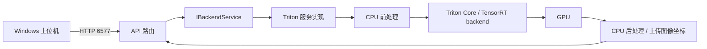

# Triton Back

独立的 C++ 模型后端。项目自带源码、配置、两个 TensorRT 模型仓库、ONNX 源文件及真实像素测试样本。将项目同步到具有已验证环境的 WSL 后，在原生 Linux 文件系统中构建、运行；编译和推理均不需要其他工程的文件。

## 按职责分层

生产 C++ 源码统一放在 `src/`；测试、运行配置、模型、部署脚本和文档仍保留在项目根目录各自的文件夹中。

| 目录 | 职责 |
| --- | --- |
| `src/app/` | 程序入口、配置选择、对象装配、进程信号处理 |
| `src/run.sh` | Linux/WSL 研发启动：自动增量构建、前台运行 |
| `src/api/` | HTTP 路由、multipart/metadata 校验、JSON 编解码、HTTP 任务队列 |
| `src/services/` | `IBackendService` 服务契约、模型与运行参数类型 |
| `src/services/impl/` | Triton C API 实现、模型生命周期、推理请求所有权和背压 |
| `src/configuration/` | YAML/JSON 配置读取及约束检查 |
| `src/domain/` | 原始图像、检测结果、请求和错误定义 |
| `src/inference/` | PNG 解码、原始像素转换、CPU 前处理、检测解析与坐标还原 |
| `config/` | 服务配置与业务模型注册信息 |
| `models/` | Triton 模型仓库与 Engine/ONNX 校验清单 |
| `model_sources/` | 两个原始 ONNX，用于后续重新生成 Engine |
| `scripts/windows/` | Windows 同步、构建、启动、停止、状态查询入口 |
| `scripts/wsl/` | WSL 原生构建与前台启动入口 |
| `tools/` | 部署管理、安全同步、环境信息采集工具 |
| `tests/` | 单元测试、GPU 集成、真实图片业务与 HTTP 协议验证 |
| `docs/` | Windows 上位机接入、部署和环境说明 |

API 层只依赖服务接口，`src/app` 将接口与 Triton 实现装配起来。模型执行通过进程内 C API 调用，前后处理与业务接口都在同一个 C++ 进程内。



## 克隆环境、更新项目、构建与启动

WSL 原生项目目录为 `/opt/triton_back`，运行库位于 `/opt/triton/2.71.0`。系统已安装 CUDA 13.3.1、TensorRT 11.1.0.106、OpenCV 4.6、GCC 13.3 和 CMake 3.28；项目构建使用系统 CMake，不依赖 Triton 编译暂存目录。

在已配置上述依赖的 WSL 环境中首次克隆时，显式使用部署目录名：

```bash
cd /opt
git clone https://github.com/liuuki-go/triton_server.git triton_back
cd /opt/triton_back
bash scripts/wsl/build.sh 4
```

仓库包含源码、配置、正式 Plan、ONNX、测试及文档；`runtime/`、`build/`、`bin/`、Python 缓存和本机环境状态快照不入库。构建会创建需要的运行目录和可执行文件；Triton、CUDA、TensorRT 系统运行库需要事先配置。

研发人员在 Linux/WSL 终端进入项目后可直接启动：

```bash
bash src/run.sh
# 启动时加载 best 的业务版本 2.0.0
bash src/run.sh --model-id best --model-version 2.0.0
# 性能测量使用 Release
bash src/run.sh --release --model-id best --model-version 2.0.0
```

该入口自动增量编译服务，默认 Debug、4 个编译任务，分别使用 `build/dev-debug`、`build/dev-release`；日志直接显示在终端，Ctrl+C 正常停止。默认读取 `config/server.yaml`，当前 `autoStart: false`，所以零参数只启动 HTTP，之后可调用选择接口加载模型。模型参数均可省略，提供时 ID 和业务版本需成对。可选 `--config FILE`、`--jobs N`，完整用法见 `bash src/run.sh --help`。也可进入 `src` 后运行 `./run.sh`，或从其他工作目录使用脚本的完整路径。

`src/app/main.cpp` 中的 `main()` 是 C++ 服务入口，由 CMake 编译成可执行程序；`src/run.sh` 负责构建并直接运行它。此研发入口按脚本位置查找可写项目目录，不要求固定 `/opt/triton_back` 或使用 Windows 管理工具。运行仍需要已安装项目依赖；`TRITON_ROOT` 环境变量应与 YAML 的 `triton.root` 一致，默认 `/opt/triton/2.71.0`。

在 Windows PowerShell 中执行：

```powershell
& D:\codes\triton_back\scripts\windows\backend.ps1 -Action Sync -Distribution template-clone
& D:\codes\triton_back\scripts\windows\backend.ps1 -Action Build -Distribution template-clone
& D:\codes\triton_back\scripts\windows\backend.ps1 -Action Start -Distribution template-clone
& D:\codes\triton_back\scripts\windows\backend.ps1 -Action Status -Distribution template-clone
```

`Sync` 更新 WSL 原生项目文件并检查传输内容，排除 Windows 的运行状态、构建目录和缓存。已有部署配置默认保留，新的配置供审查；确认需要使用项目配置时可传 `-ReplaceConfig`。`Build` 进行 Release 构建、CPU 测试并发布二进制。`Start` 持有前台 WSL 会话，启动 C++ 进程并等待状态可查询；同时提供 `-ModelId best -ModelVersion 2.0.0` 才会加载指定模型。

本机部分 C++ 源文件由 Windows 文件系统透明加密；直接从 WSL 读取挂载源码会得到物理密文。同步工具使用 Windows Python 的正常文件读取接口获取源码，按实际字节长度打包并校验后写入 WSL 原生文件系统。同步时自动寻找可用 Python，也可传 `-PythonExe`；启动、停止和状态查询不要求 Windows Python。工具不修改文件加密或系统安全设置。

若已经在 WSL 原生目录更新了完整项目，可直接构建和运行：

```bash
cd /opt/triton_back
bash scripts/wsl/build.sh
bash scripts/wsl/run.sh
```

`run.sh` 保持前台进程。默认 `autoStart: false`，未指定模型时只开放 HTTP，由上位机查询目录并调用 `POST /api/models/select` 加载模型。直接启动二进制时使用 `--config /opt/triton_back/config/server.yaml`；无参数运行也优先查找二进制旁的部署配置。

环境克隆的命令及限制见 [environment.md](docs/environment.md)。WSL 克隆保留 Linux 运行库，GPU 驱动来自 Windows；更换 GPU 或 TensorRT 版本后应重新验证或构建 Engine。

## Windows 上位机接入

上位机负责启动并持有 `wsl.exe` 前台会话，持续读取标准输出和错误输出，避免日志管道阻塞。启动顺序：创建后端进程 → `GET /api/status?simple=true` 查询简要状态和所有注册版本 → `POST /api/models/select` 指定 `ModelId` 和 `RequestedModelVersion` → 确认响应的 `modelReady: true` 且 `activeModel` 匹配 → 提交推理。首次加载和运行中切换使用同一个选择接口，HTTP 进程无需重启。

启动后调用 `http://127.0.0.1:6577/infer`。multipart 只有 `metadata` JSON 和 `image` 文件二进制两部分，必须声明 `Content-Length`。上位机使用 PNG 时填写 `ImageEncoding: "Png"`，`image` 上传完整 PNG 文件字节，类型为 `image/png` 或 `application/octet-stream`；无需 Base64，也无需上传原始像素布局。metadata 保留模型、业务版本、相机、帧号、尺寸、源像素格式与可选置信度。

PNG 的 `Width`、`Height` 必须与文件像素尺寸一致，`PixelFormat`、`StrideBytes`、`RowOrder` 不必提供。支持灰度、彩色及带透明通道的 PNG，每通道最多 8 位；透明度被忽略，解码后的 BGR 像素最多 64 MiB。仍兼容 `ImageEncoding: "Raw"`，此时上述三个原始像素布局字段仍为必填。

| 接口 | 用途 |
| --- | --- |
| `GET /api/status` | 默认返回完整状态；`?simple=true` 只返回简要状态、模型版本及文件可用性；有效查询返回 200，`modelReady` 表示可推理 |
| `POST /api/models/select` | 显式指定 `ModelId`、`RequestedModelVersion`；成功只返回 `ok`、`modelReady`、`activeModel`，失败另含 `error`、`message` |
| `POST /infer` | 唯一推理入口 |

状态查询支持 `?simple`、`?simple=true` 或 `?simple=1` 返回简版；不传参数、`?simple=false` 或 `?simple=0` 返回原有完整版。非法取值或值不同的重复 `simple` 参数返回 `400 INVALID_QUERY`，相同值重复按一个值处理。简版字段与示例见 [windows-host.md](docs/windows-host.md)。选择接口固定返回最小结果，`activeModel` 为 null 或仅含 `id`、`version`；新模型成功才切流，失败保持旧模型。详细状态和诊断信息另查 `GET /api/status`。

Apifox 调试可直接导入 [Postman Collection 文件](docs/triton-back.postman_collection.json)：在「导入」中选择 Postman，上传 JSON，并同时导入、选中同名环境。文件包含以上三个接口和 `best / 2.0.0` 请求示例，默认地址 `http://127.0.0.1:6577`，首个请求默认查询简版状态；禁用 `simple` 参数或改为 `false` 可查询完整版。推理前在 `image` 中选择本地 PNG，将 `metadata` 的 `Width`、`Height` 改为图片实际尺寸，并确认该表单字段的 Content-Type 为 `application/json`。

上位机只做等比例缩放；后端负责 letterbox、RGB/NCHW/归一化和坐标还原。返回框位于上传图像坐标系，并回显请求关联字段。详细启动流程与 C# 示例见 [windows-host.md](docs/windows-host.md)。

结束整个进程使用：

```powershell
& D:\codes\triton_back\scripts\windows\backend.ps1 -Action Stop -Distribution template-clone
```

不提供单独的模型停止接口。切换成功后，旧模型处理完已经接收的请求便自动卸载。管理工具结束进程时先发送 SIGTERM，排空请求并清理模型；超时后重新核验 PID/启动时间/owner token，再结束对应进程。

## 配置与当前范围

`config/server.yaml` 设置端口、请求大小、线程、Triton 路径、模型仓库和在途上限。`config/models.json` 每条记录管理一个业务模型版本，允许同一 `id` 配置多个不同的 `businessVersion`，分别映射到整数 `tritonVersion`。指定版本加载时，服务在同一 Triton Core 内为每次加载建立独立运行实例，通过 C API 根据该记录生成版本、张量、合批及 GPU 实例配置。仓库 `config.pbtxt` 保留旧版单图静态配置作为直接加载的后备，本服务会覆盖它；修改配置后需重启整个 C++ 进程。

同一时刻只有一个模型版本接收新推理。查询不加载模型；不存在的模型、业务版本或 Engine 文件返回明确的 404 错误。新模型准备期间旧模型持续服务，状态保持 `running`，`switching: true` 和 `pendingModel` 表示正在准备的目标。首次加载时为 `starting`、`modelReady: false`。新模型成功后原子切换，旧请求继续完成，旧实例在途归零后自动卸载；`retiringModels` 直到物理卸载及注销完成才移除。加载失败不改变旧实例，无需重新加载旧模型。推理请求必须匹配当前选择，切流后提交的旧模型请求返回 `409 MODEL_NOT_ACTIVE`。

切换期间显存需容纳新旧实例，显存不足会返回加载错误并保持旧模型；并行加载和推理仍可能出现延迟波动。旧实例清理错误通过 `retiringModels[].cleanupError` 单独报告并重试，不把已成功生效的新模型标记为切换失败。

已知模型版本时，也可随进程启动参数传入：`bash scripts/wsl/run.sh --model-id best --model-version 2.0.0`。Windows 工具对应 `-Action Start -ModelId best -ModelVersion 2.0.0`；完整协议和 C# 示例见接入文档。

`best/1.0.0` 保留原单图 Engine；`best/2.0.0` 使用新建的 FP32、禁用 TF32 的动态 batch Engine，输入固定 960，batch profile 为最小 1、最佳 4、最大 8。默认 `instanceCount: 1`，`batching` 为 `maxBatchSize: 8`、`preferredBatchSizes: [4]`、`maxQueueDelayMicroseconds: 10000`，面向默认 4 相机并发。每个 HTTP 请求仍上传一张 PNG；Triton 尽量合成 4 张执行，等待预算耗尽可执行小批次，不保证来自不同相机或同一拍次。调整首选批量和等待时间无需重建 Engine，批量超过 8 则必须重建；配置与重建命令见 [deployment.md](docs/deployment.md)。

`best` 各版本均为 20 类；`yolo26n/1.0.0` 为 640 输入、80 类，继续使用单图模式。动态模型状态中的张量为 `images[-1,3,960,960]`、`output0[-1,300,6]`，`-1` 表示内部 batch 轴；单个请求仍返回自己的检测结果。通过 `activeModel.executionStatistics` 的执行计数和 `batch_stats` 核对实际合批，不能只看客户端并发数。

`best/3.0.0` 是可选的 TF32 版本，映射到 `models/best/3/model.plan`，沿用相同 960 输入、1/4/8 profile 和合批配置。输入输出仍为 FP32，内部允许 TF32 与 FP32 执行策略混用；重建命令见 [deployment.md](docs/deployment.md)。选择方式为 `ModelId: "best"`、`RequestedModelVersion: "3.0.0"`，或启动时传 `-ModelId best -ModelVersion 3.0.0`。示例继续选择 FP32 的 `2.0.0`。

TF32 不满足原 FP32 的数值一致性阈值：377 张对照有 5 张检测数量变化；在数量和类别分布相同的图片中，对应框最大置信度差约 0.0885、最大坐标差约 10.30 像素。此比较没有标注真值，不能判断准确率升降。仓库保存了 [本机 benchmark 与差异摘要](docs/benchmarks/tf32-20261016.json)，TF32 的传输回归使用同一 Engine、同一像素、各实际 batch 的独立直接 TensorRT 参考；原 FP32 参考及其严格阈值保持不变。

同轮四相机测试中，FP32 `2.0.0` → TF32 `3.0.0` 的吞吐量中位数：WSL 内为 **25.40 → 28.05 张/秒（+10.4%）**，Windows 上位机路径为 **25.33 → 29.05 张/秒（+14.7%）**。测量采用相同图片、批量配置、预热和三轮重复；各实际批量统计及延迟分布保存在上述摘要中。

完整请求最多 8 个在途，满时返回 `503 SERVICE_BUSY`。`timingsMs.tritonRequest` 包含合批等待、排队、传输和执行，并非纯 GPU 时间。大量慢速上传耗尽 HTTP 工作线程时，控制接口仍可能延迟。

本机使用 377 张光伏缺陷图片、每轮四路同时发图且等全部返回、三轮测试：旧版到动态合批版本的吞吐量中位数，WSL 内为 20.34 → 25.83 张/秒，Windows 上位机路径为 20.39 → 24.90 张/秒。实际批量统计、逐图数值对照和完整参数见 `build/dynamic-batch-20261016/summary.json`；结果对应本机和该负载，未标定其他硬件或负载的吞吐上限。真实图片参考用于检查迁移结果，不能替代标注数据的准确率验证。

## 验证

```bash
cd /opt/triton_back
source /opt/triton/2.71.0/setup_env.sh
ctest --test-dir build -L unit --no-tests=error --output-on-failure
ctest --test-dir build -L gpu --no-tests=error --output-on-failure
python3 tests/integration/test_business.py
python3 tests/integration/test_business_reference.py
python3 tests/scripts/test_run.py
python3 tests/protocol/testProtocol.py --output build/verification/protocol-report.json
python3 tools/environment/collect_environment.py --output /root/system_env_info.txt --copy-to docs/system_env_info.txt
```

GPU 集成测试使用本项目的两个 raw 输入及保存的直接 TensorRT 检测参考，检查模型生命周期、版本切换、失败保持旧模型、并发背压和旧请求排空，以及 FP32 / TF32 各实际批量的结果对照。业务测试依次选择全部已配置模型版本，验证 PNG/Raw 及当前模型下的混合编码并发。协议测试会执行模型加载与切换，运行这些测试时应安排专用测试窗口。本地完整日志位于 `build/verification`、`build/dynamic-batch-20261016`、`build/tf32-batch-20261016`，不入库；TF32 摘要保存在 `docs/benchmarks`。环境采集命令生成 `/root/system_env_info.txt` 及可选的 `docs/system_env_info.txt` 本机快照，均不作为仓库交付文件。
